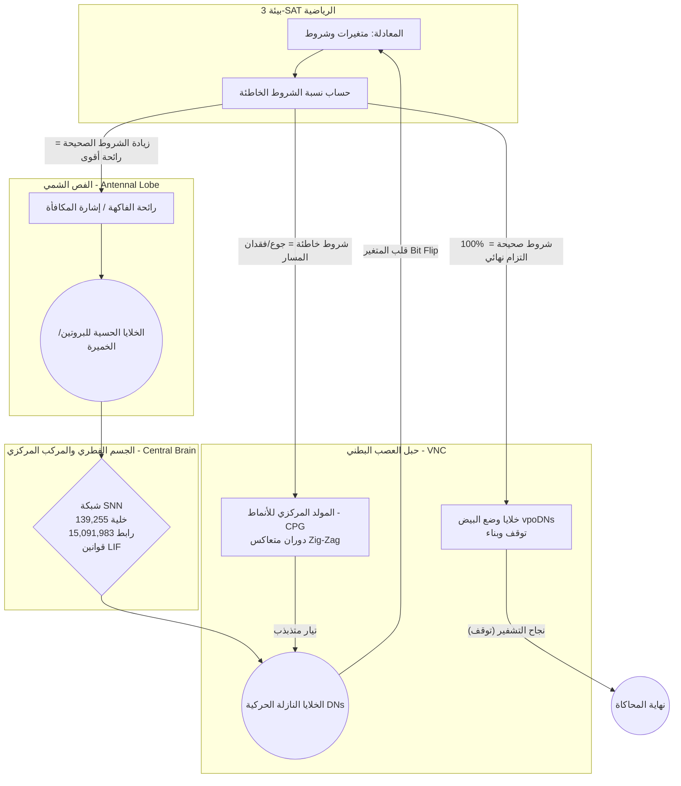

# الهيكل المعماري لنموذج ذبابة الفاكهة لحل (3-SAT)

## 1. المخطط البياني (Architecture Graph)
المخطط التالي يوضح مسار الإشارات وكيف تحاكي كل خطوة سلوكاً بيولوجياً حقيقياً لذبابة الفاكهة:



---

## 2. مطابقة الكود مع التصرفات الحقيقية لذبابة الفاكهة

كل خطوة في المحاكي تم تصميمها لتمثل سلوكاً بيولوجياً ثابتاً ومثبتاً في الأبحاث:

| الجزء البرمجي في الكود | السلوك الحقيقي لذبابة الفاكهة (Biology) | الوظيفة الرياضية لحل (3-SAT) |
| :--- | :--- | :--- |
| **الخلايا الحسية (Sensory Candidates)** | **(Antennal Lobe)**: تستقبل روائح الطعام مثل الخميرة والبروتين لتقييم البيئة. | تستقبل الإشارة الكهربائية (Odor) التي تمثل عدد الشروط المحققة في المعادلة. |
| **محاكي LIF SNN (snn_simulator.py)** | **(Mushroom Body & Central Complex)**: يعالج إشارات الروائح ويتعلم منها لتوجيه الحركة. | يمرر الإشارات عبر 15 مليون رابط للبحث عن مسار الحل وكسر التناقضات. |
| **خوارزمية (Cast and Surge)** | الذبابة تندفع للأمام عند التقاط الرائحة (Surge) وتتخبط يميناً ويساراً عند فقدانها (Cast). | الاستمرار في تثبيت المتغيرات الصحيحة، وتغيير المتغيرات الخاطئة (Exploration vs Exploitation). |
| **المولد النمطي (CPG Zig-Zag)** | الخلايا تولد نمطاً حركياً منتظماً كالموجة لمسح الجوار المحلي بدقة عند فقدان مسار الطعام. | يرسل موجة جيبية (Sine Wave) تقلب المتغيرات بشكل متسلسل بدلاً من القفز العشوائي. |
| **خلايا الإخراج الحركية (Motor Candidates)** | **(Descending Neurons)**: الخلايا التي تنقل الأوامر النهائية لتحريك الأجنحة أو الأرجل. | العقد العصبية التي يترجم انفجارها (Bursting) إلى قلب قيمة المتغير (Bit Flip 0 -> 1). |
| **الالتزام النهائي (Oviposition)** | الإناث تقيم موقع وضع البيض بصرامة ولا تلتزم بوضع البيض إلا إذا كانت البيئة مثالية 100%. | الكود لا يوقف البحث إلا عندما يصل عدد الشروط الخاطئة لصفر (Perfect Assignment). |

---

## 3. ما الذي يختبره الكود الحالي بالضبط؟
الكود الحالي يقوم بتوليد **معادلة 3-SAT عشوائية صغيرة** (20 متغير و 85 شرط). 
الهدف من هذا الاختبار الحالي ليس تقييم قوة النظام في كسر التشفير العالمي (الذي يتطلب آلاف المتغيرات)، بل الهدف هو **إثبات المبدأ (Proof of Concept)**. نحن نختبر:
1. هل 15 مليون رابط تعمل معاً دون انهيار الذاكرة؟
2. هل المحاكي قادر على نقل الإشارات من الخلايا الحسية للحركية بنجاح؟
3. هل سلوك الذبابة (الاندفاع والتخبط) قادر على خفض الأخطاء تدريجياً (Gradient Descent) بدلاً من التجمد؟

بمجرد ضبط المعاملات وإثبات كفاءة هذه المعادلة الصغيرة، سننتقل لتحميل ملفات `CNF` القياسية المأخوذة من المسابقات العالمية للتشفير.

---

## 4. الكود المصدري الكامل للمحاكي (Full Source Code)

### أولاً: المحرك البيولوجي (snn_simulator.py)
هذا هو الدماغ الذي يعتمد على معادلات (Shiu et al. 2024).

```python
"""
Leaky Integrate-and-Fire (LIF) Spiking Neural Network Simulator.
Based on the biological parameters from Shiu et al. (2024) for Drosophila.
"""

import time
from pathlib import Path
import numpy as np
import torch
import torch.nn.functional as F

V_REST = -52.0
V_RESET = -52.0
V_TH = -45.0
TAU_M = 20.0
TAU_S = 5.0
W_SYN = 0.275
T_REFRACTORY = 2.2
DELAY_MS = 1.8

class FlyBrainSNN:
    def __init__(self, graph_path: Path, dt: float = 1.0, device: str = "cuda"):
        self.device = torch.device(device if torch.cuda.is_available() else "cpu")
        self.dt = dt
        self.delay_steps = max(1, int(DELAY_MS / dt))
        self.refractory_steps = max(1, int(T_REFRACTORY / dt))

        data = torch.load(graph_path, map_location=self.device, weights_only=False)
        self.N = len(data["root_ids"])
        values = data["val"].to(torch.float32) * W_SYN
        crow = data["crow"].to(torch.int32)
        col = data["col"].to(torch.int32)
        
        self.W = torch.sparse_csr_tensor(crow, col, values, size=(self.N, self.N), device=self.device)
        self.v = torch.full((self.N, 1), V_REST, device=self.device, dtype=torch.float32)
        self.i_syn = torch.zeros((self.N, 1), device=self.device, dtype=torch.float32)
        self.spike_buffer = torch.zeros((self.delay_steps, self.N, 1), device=self.device, dtype=torch.float32)
        self.buffer_idx = 0
        self.refractory_time = torch.zeros((self.N, 1), device=self.device, dtype=torch.int32)
        self.alpha_m = np.exp(-dt / TAU_M)
        self.alpha_s = np.exp(-dt / TAU_S)
    
    def step(self, external_current: torch.Tensor = None) -> torch.Tensor:
        self.i_syn = self.i_syn * self.alpha_s
        delayed_spikes = self.spike_buffer[self.buffer_idx]
        synaptic_input = torch.sparse.mm(self.W, delayed_spikes)
        self.i_syn += synaptic_input
        self.v = V_REST + (self.v - V_REST) * self.alpha_m
        
        total_input = self.i_syn
        if external_current is not None:
            total_input += external_current
            
        active_mask = (self.refractory_time == 0)
        self.v += total_input * active_mask
        
        spikes = (self.v >= V_TH) & active_mask
        self.v[spikes] = V_RESET
        self.refractory_time[spikes] = self.refractory_steps
        self.refractory_time = torch.clamp(self.refractory_time - 1, min=0)
        
        self.spike_buffer[self.buffer_idx] = spikes.float()
        self.buffer_idx = (self.buffer_idx + 1) % self.delay_steps
        return spikes
```

### ثانياً: بيئة التشغيل وسلوك الذبابة (sat_environment.py)
هذا هو الكود الذي يطبق الحركة البيولوجية (الاندفاع والتخبط اللولبي) على المعادلات.

```python
"""
3-SAT Virtual Fly Environment (Biomimetic Architecture).
Implements:
1. Oviposition (Strict commitment at 100% satisfaction)
2. Cast & Surge (Foraging behavior)
3. CPG Zig-Zag (Structured spatial search via oscillating currents instead of random noise)
"""

import time
import argparse
from pathlib import Path
import torch
import numpy as np
from snn_simulator import FlyBrainSNN

def generate_random_3sat(n_vars: int, n_clauses: int, seed: int = 42):
    rng = np.random.default_rng(seed)
    clauses = []
    for _ in range(n_clauses):
        vars_idx = rng.choice(n_vars, 3, replace=False)
        signs = rng.choice([True, False], 3)
        clauses.append((vars_idx, signs))
    return clauses

def check_clauses(assignment: torch.Tensor, clauses: list):
    n_clauses = len(clauses)
    is_satisfied = torch.zeros(n_clauses, dtype=torch.bool, device=assignment.device)
    for i, (vars_idx, signs) in enumerate(clauses):
        v1, v2, v3 = vars_idx
        s1, s2, s3 = signs
        eval1 = (assignment[v1] == 1.0) if s1 else (assignment[v1] == 0.0)
        eval2 = (assignment[v2] == 1.0) if s2 else (assignment[v2] == 0.0)
        eval3 = (assignment[v3] == 1.0) if s3 else (assignment[v3] == 0.0)
        is_satisfied[i] = eval1 or eval2 or eval3
    return is_satisfied

def get_user_input(prompt: str, default: int | float, type_cast: type):
    user_val = input(f"{prompt} [Default: {default}]: ").strip()
    if not user_val:
        return default
    try:
        return type_cast(user_val)
    except ValueError:
        print(f"Invalid input. Using default: {default}")
        return default

def main():
    print("="*50)
    print("Virtual Fly 3-SAT (Interactive Setup)")
    print("="*50)
    
    n_vars = get_user_input("Enter Number of Variables (--vars)", 20, int)
    n_clauses = get_user_input("Enter Number of Clauses (--clauses)", 85, int)
    max_steps = get_user_input("Enter Max Simulation Steps (--max-steps)", 10000, int)
    max_cpg = get_user_input("Enter Max CPG Wave Amplitude (--max-cpg)", 10.0, float)
    print("="*50)

    ROOT = Path(__file__).resolve().parents[1]
    graph_path = ROOT / "data" / "processed" / "graph_783.pt"
    
    brain = FlyBrainSNN(graph_path, dt=1.0)
    
    data = torch.load(graph_path, map_location="cpu", weights_only=False)
    crow = data["crow"].numpy()
    col = data["col"].numpy()
    N = len(data["root_ids"])
    
    in_degree = crow[1:] - crow[:-1]
    out_degree = np.zeros(N, dtype=np.int32)
    unique, counts = np.unique(col, return_counts=True)
    out_degree[unique] = counts

    # استخراج الخلايا الحركية (Motor candidates)
    motor_candidates = np.where((out_degree <= 20) & (in_degree >= 20))[0]
    
    rng = np.random.default_rng(777)
    motor_nodes = rng.choice(motor_candidates, n_vars, replace=False)
    
    clauses = generate_random_3sat(n_vars, n_clauses)
    assignment = torch.randint(0, 2, (n_vars,), device=brain.device, dtype=torch.float32)
    
    window_size = 5
    motor_spike_history = torch.zeros((n_vars, window_size), device=brain.device)
    
    best_unsat = n_clauses
    
    for step in range(max_steps):
        is_sat = check_clauses(assignment, clauses)
        sat_count = is_sat.sum().item()
        unsat_count = n_clauses - sat_count
        
        if unsat_count < best_unsat:
            best_unsat = unsat_count
            print(f"Step {step:4d} | New Best! Unsatisfied: {unsat_count:3d} / {n_clauses} (Surge / Reward)")
            
        if unsat_count == 0:
            print(f"\n[SUCCESS - OVIPOSITION COMMIT] Ground State Reached! All clauses satisfied at step {step}.")
            break

        # CPG ZIG-ZAG DYNAMICS
        hunger_ratio = unsat_count / n_clauses 
        current_amplitude = max_cpg * hunger_ratio
        
        ext_current = torch.zeros((brain.N, 1), device=brain.device)
        
        if current_amplitude > 0:
            phases = (step / 3.0) + (torch.arange(n_vars, device=brain.device) / n_vars) * 2.0 * np.pi
            cpg_wave = torch.sin(phases) * current_amplitude
            cpg_injection = torch.clamp(cpg_wave, min=0.0)
            
            ext_current[motor_nodes, 0] += cpg_injection
            
            thermal_noise = torch.randn((brain.N, 1), device=brain.device) * 0.1
            ext_current += thermal_noise
            
        spikes = brain.step(external_current=ext_current)
        
        # MOTOR DECODING (Bit Flips)
        motor_spikes = spikes[motor_nodes].squeeze(-1)
        motor_spike_history[:, step % window_size] = motor_spikes.float()
        
        motor_rates = motor_spike_history.sum(dim=1)
        flip_mask = motor_rates >= (window_size * 0.6)
        
        if flip_mask.any():
            assignment[flip_mask] = 1.0 - assignment[flip_mask]
            motor_spike_history[flip_mask, :] = 0.0

if __name__ == "__main__":
    main()
```
