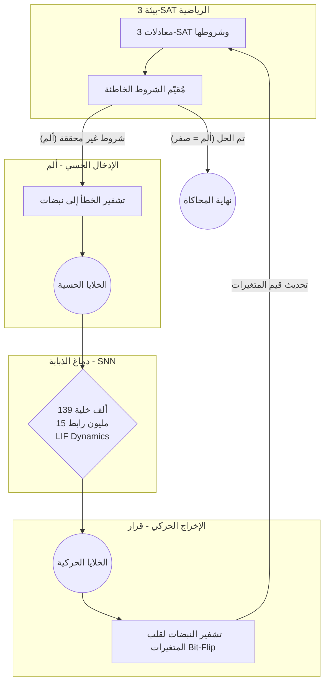

# خريطة معمارية النموذج: الذبابة الافتراضية (Virtual Fly 3-SAT Solver)

تعتمد معماريتنا على محاكاة طريقة الذبابة في البحث عن الطعام والهروب من الألم (النقاط العمياء أو Local Minima). يتم تحويل المعادلة الرياضية المعقدة (3-SAT) إلى بيئة تفاعلية تعيش فيها هذه الذبابة.

## المخطط المعماري (Architecture Diagram)

## شرح الأجزاء الرئيسية

### 1. بيئة الرياضيات (3-SAT Environment)
- **الوظيفة:** توليد وحفظ المتغيرات الخاصة بمعادلة 3-SAT (مثلاً: 100 متغير و 430 شرط). 
- **آلية العمل:** تقوم في كل جزء من الثانية بحساب عدد الشروط (Clauses) التي لم تتحقق بناءً على التكوين الحالي للمتغيرات (0 أو 1).

### 2. التشفير الحسي (Sensory Encoding)
- **الوظيفة:** تحويل المشكلة الرياضية إلى لغة بيولوجية.
- **آلية العمل:** كل شرط (Clause) غير محقق يولد "نبضات كهربائية" (Spikes) يتم إدخالها إلى مجموعة من الخلايا الحسية (Sensory Neurons) في دماغ الذبابة. هذا يمثل شعور الذبابة بالضغط أو الانزعاج (Biological Pain).

### 3. الدماغ البيولوجي (The SNN Brain)
- **الوظيفة:** معالجة الإشارات بطريقة ديناميكية وغير خطية للهروب من الأخطاء.
- **آلية العمل:** مصفوفة الـ 15 مليون رابط تتلقى إشارات الانزعاج، وتبدأ في التفاعل والتخبط المدروس (Stochastic Search & Cast-and-Surge). تعقيد الروابط وتشابكها يمنع الشبكة من التعلق في حلول جزئية (Local Minima).

### 4. فك التشفير الحركي (Motor Decoding)
- **الوظيفة:** استخراج الحل الرياضي من حركة الذبابة.
- **آلية العمل:** يتم تخصيص خلايا حركية (Motor Neurons) لتمثل المتغيرات (Variables). إذا وصل نشاط خلية حركية معينة إلى حد الانفجار (Bursting)، يتم عكس قيمة المتغير الخاص بها (مثلاً من 0 إلى 1). 
- **النتيجة:** بمجرد أن تصبح كل الشروط محققة، ينعدم الألم (الإدخال الحسي)، وتهدأ الشبكة تماماً، مما يعني أننا وصلنا إلى الحل النهائي للمعادلة الرياضية المعقدة (Satisfiability).
